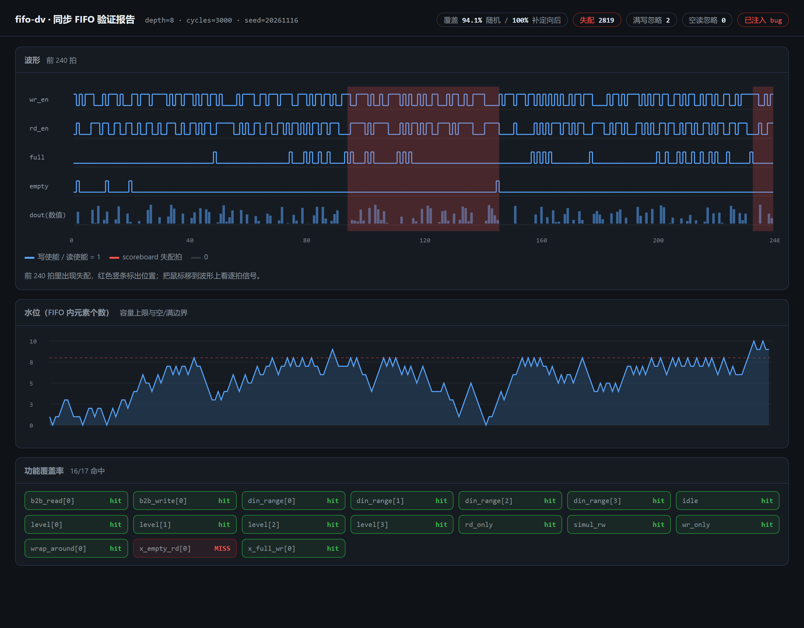
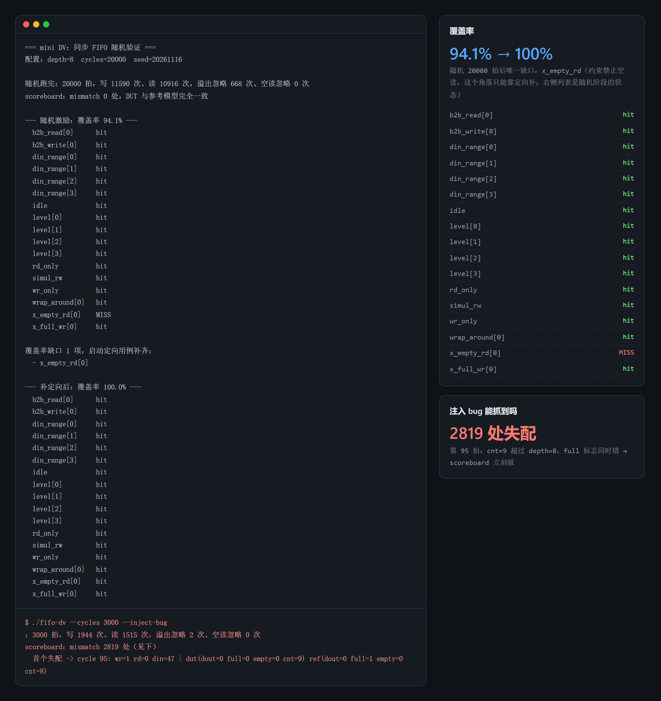

# fifo-dv

一个**不依赖 EDA 的 mini DV 平台**：被测逻辑是同步 FIFO，验证平台按 UVM 的分层复现一遍 —— 约束随机激励、参考模型、scoreboard、功能覆盖率，外加一个错误注入开关，用来证明这套平台真的能抓到 bug。

没有 Verilator、没有 Questa、没有 UVM 库，全是 C++ 标准库。做它的目的不是替代商业工具，而是把「验证方法学」本身跑通一遍：为什么随机不能只随机、覆盖率到 100% 意味着什么、scoreboard 为什么要独立于 DUT。





## 平台结构

```
generator(CRV)  ──transaction──▶  driver  ──引脚──▶  DUT(sync FIFO)
      │                                                 │
      │ 同一组激励                                         │ 采样
      ▼                                                 ▼
 reference model ─────────────期望值─────────────▶ scoreboard ──▶ mismatch
                                                        │
                                                     coverage（功能覆盖点 + 交叉覆盖）
```

关键点：**reference model 是独立实现的**（用 `std::vector` 当队列），不是拿 DUT 的内部状态当期望值。否则 DUT 错了，期望值也跟着错，永远比不出问题。

## 覆盖率模型

| 覆盖点 | 含义 |
|---|---|
| `wr_only` / `rd_only` / `simul_rw` / `idle` | 四种动作组合，同拍读写最容易出 bug |
| `level[0..3]` | 水位：空 / 低 / 高 / 满 |
| `din_range[0..3]` | 数据边界：0 / 小值 / 大值 / 全 1（255 最容易暴露位宽截断） |
| `x_full_wr` | 满的时候还给了写使能 |
| `x_empty_rd` | 空的时候还给了读使能 |
| `b2b_write` / `b2b_read` | 连续两拍同向操作（背靠背） |
| `wrap_around` | 写满之后读走再写，指针回绕 |

## 可视化报告

终端只有数字，看不出时序。所以加了一个单文件报告（内嵌数据，双击打开，不需要服务器）：

```bash
./fifo-dv --json trace.json                 # 导出信号窗口 + 覆盖率
python tools/report.py trace.json docs/report.html
```

报告里有三块：

- **波形**：`wr_en / rd_en / full / empty / dout` 逐拍电平，鼠标悬停看该拍全部信号值；scoreboard 失配的拍用红色竖条标出（上面那张图里 110–150 拍之间那两条红带就是注入 bug 后的失配窗口）
- **水位曲线**：FIFO 内元素个数随时间变化，虚线是容量上限，能直观看到「涨到满、回绕、掉空」的过程
- **覆盖率网格**：17 个 bin 逐个显示 hit / MISS，`x_empty_rd` 是唯一没命中的那个

## 跑起来

```bash
g++ -std=c++17 -O2 -static -Isrc src/main.cpp -o fifo-dv
./fifo-dv                                   # 20000 拍随机 + 定向
./fifo-dv --seed 42 --cycles 5000 --depth 16
./fifo-dv --inject-bug                      # 注入 bug，看平台能不能抓到
./fifo-dv --cov-json cov.json               # 只导出覆盖率（体积小，适合多 seed 批量跑）
```

`--cov-json` 会同时写两份 bin：`bins` 是补完定向用例后的最终覆盖率，`randomBins` 是**随机阶段的快照**。
后者才有诊断价值——三个 seed 各跑一遍，缺的都是同一个 `x_empty_rd[0]`，说明这个洞不是随机性不够，
而是生成器约束主动排除了「空读」这种非法场景，必须靠定向用例补：

```bash
for s in 1 2 3; do ./fifo-dv --seed $s --cov-json out/cov_$s.json >/dev/null; done
# seed 1 随机 94.1 → 最终 100.0   随机缺口 x_empty_rd[0]
# seed 2 随机 94.1 → 最终 100.0   随机缺口 x_empty_rd[0]
# seed 3 随机 94.1 → 最终 100.0   随机缺口 x_empty_rd[0]
```

## 实测

**干净 DUT（20000 拍，seed=20261116）**

```
随机跑完：20000 拍，写 11590 次、读 10916 次，溢出忽略 668 次、空读忽略 0 次
scoreboard：mismatch 0 处，DUT 与参考模型完全一致
--- 随机激励：覆盖率 94.1% ---
覆盖率缺口 1 项：x_empty_rd[0]
--- 补定向后：覆盖率 100.0% ---
结论：随机 20000 拍覆盖 94.1%（缺 1 项）；补 3 个定向用例后 100.0%
```

**唯一缺的那一项很说明问题**：`x_empty_rd`（空的时候给读使能）随机永远打不到，因为生成器有约束「空时不读」——约束排除了非法场景，也就同时排除了这个覆盖点。这类角落只能靠定向用例补，这就是「随机 + 定向」要配比的原因，不是覆盖率虚荣指标。

**注入 bug（满写不忽略，3000 拍）**

```
配置：depth=8  cycles=3000  seed=20261116  [已注入 bug：满写不忽略]
scoreboard：mismatch 2819 处
  首个失配 -> cycle 95: wr=1 rd=0 din=47 | dut(dout=0 full=0 empty=0 cnt=9) ref(dout=0 full=1 empty=0 cnt=8)
```

第 95 拍就抓住了：`cnt=9` 超过了 `depth=8`，`full` 标志也跟着错。**这条比覆盖率 100% 更能说明平台有效**——能抓到人为注入的 bug，才证明它不是摆设。

## 复现性

随机种子固定在同一处，`--seed` 可指定。同一个 seed 跑出来的激励序列完全一致，出了 mismatch 能原地复现——这是约束随机验证的基本要求，做不到就没法定位问题。

## 和真实验证环境的关系

| 这套 | UVM 里对应 |
|---|---|
| `Gen` + 约束 | `uvm_sequence` + `constraint` |
| `driver` | `uvm_driver` |
| `RefModel` | reference model / `uvm_scoreboard` 里的期望值来源 |
| `stepOne` 里的比对 | `uvm_scoreboard` 的 compare |
| `Coverage` | `covergroup` + `bins` |

差别在于：没有 SVA、没有 UVM 的 phase 机制、没有 DPI 和 RTL 仿真。它的价值是把方法学跑通，而不是替代 `vcs -ntb`。

## 已知局限

- DUT 是 C++ 写的，不是 RTL，所以不存在时钟周期级与 RTL 的时序对齐问题
- 约束是手写 if-else，不是真正的约束求解器（没有 SAT/BDD，无法处理复杂互斥与分布控制）
- 覆盖率只统计「命中/未命中」，没有权重、没有交叉覆盖矩阵、没有覆盖率合并
- 没有 fail 后自动回归、没有 seed 批量扫描（真实 DV 里会跑几百个 seed 找角落）
